<div align="center">

# 📅 BookIt: Lab Equipment Booking System

**A full-stack booking system for shared lab equipment.**<br>
See what's free right now, drag across a calendar to book a slot, and let the system catch double bookings, uncertified users and overdue returns.

[](https://github.com/Varshini-arsh/bookit-lab-equipment-booking/actions/workflows/tests.yml)


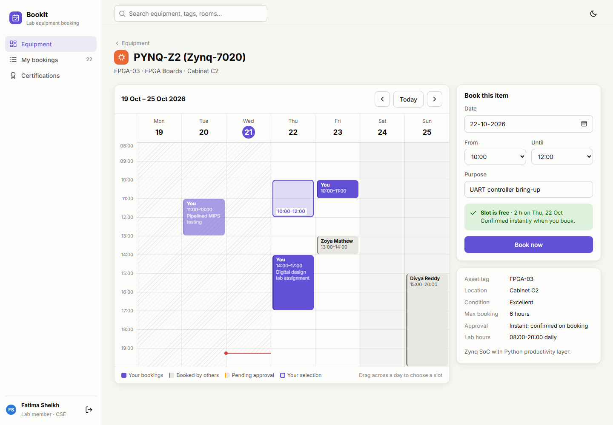

</div>

---

## 📑 Table of contents

1. [What is BookIt?](#-what-is-bookit)
2. [Case study: the shared lab behind the demo](#-case-study-the-shared-lab-behind-the-demo)
3. [Features](#-features)
4. [Roles and permissions](#-roles-and-permissions)
5. [Screenshots](#-screenshots)
6. [Tech stack](#-tech-stack)
7. [Architecture](#-architecture)
8. [Database design](#-database-design)
9. [Booking rules and lifecycle](#-booking-rules-and-lifecycle)
10. [Reports and SQL](#-reports-and-sql)
11. [REST API reference](#-rest-api-reference)
12. [Getting started](#-getting-started)
13. [Testing and CI](#-testing-and-ci)
14. [Project structure](#-project-structure)
15. [Design decisions](#-design-decisions)
16. [Future improvements](#-future-improvements)
17. [Author and license](#-author-and-license)

---

## 💡 What is BookIt?

Many university labs still use a paper sign-up sheet taped to the door. That leads to the same problems again and again:

| Problem | How BookIt solves it |
|---|---|
| **Double bookings**: two students arrive for the same oscilloscope | Overlapping bookings are rejected by the API, and you see the clash **live** while choosing a slot |
| **Unsafe use**: untrained students use the resin printer or soldering iron | Restricted categories need a **valid safety certification** before you can book |
| **Items don't come back** | Check-out and return at the lab desk, with **overdue returns** flagged for the manager and the member |
| **No data for budget requests** | **Reports**: utilisation, most-used items, usage by department, a peak-hours heatmap and **CSV export** |
| **No record of who approved what** | Every request, approval, check-out and certification change goes into an **audit log** |

BookIt is a **Django REST API** with a **MySQL database** and a **single-page frontend written in plain HTML, CSS and JavaScript**: no frontend framework and no build step.

## 🏛 Case study: the shared lab behind the demo

The demo dataset (`python manage.py seed_demo`) models a university **electronics and computing lab** shared by four departments: Electronics & Communication, Computer Science, Mechanical and Physics.

**13 items in 5 categories:**

| Category | Items | Booking rules |
|---|---|---|
| 〰️ Oscilloscopes | Keysight DSOX1204G ×2, Rigol DS1054Z | Open to all · instant · max 4 h |
| 🔲 FPGA Boards | Digilent Basys 3 ×2, PYNQ-Z2, Nexys A7 (*out for repair*) | Open to all · instant · max 6 h |
| 🖨️ 3D Printers | Prusa MK4, Formlabs Form 3 (resin) | 🔒 Certification · manager approval |
| 🖥️ GPU Workstations | RTX 4090 24 GB, 2× RTX A6000 | 🔒 Certification · manager approval |
| 🔥 Soldering Stations | Weller WE1010, Hakko FX-888D | 🔒 Certification · instant · max 3 h |

**7 people:**

| Person | Role | Certified for |
|---|---|---|
| Lakshmi Krishnan | Lab manager | n/a (approves requests and grants certifications) |
| Fatima Sheikh | PhD scholar, CSE | GPU workstations, 3D printers |
| Aditya Kulkarni | M.Tech, Mechanical | 3D printers, soldering |
| Divya Reddy | M.Tech, ECE | Soldering |
| Zoya Mathew | B.Tech, CSE | GPU workstations |
| Nikhil Verma | B.Tech, ECE | Nothing yet |
| Sameer Khan | PhD scholar, Physics | Nothing yet |

The seed also creates about **6 weeks of booking history and 10 days of future bookings**: busy late mornings, quiet weekends, a few rejections and cancellations, and pending requests. That gives the reports real patterns to show. All dates are relative to the day you run the seed.

## ✨ Features

### 🔎 Equipment catalog
- A **live status** on every card: 🟢 *Available now · next tomorrow 10:00*, 🟡 *In use until 15:30 · Fatima Sheikh*, or 🔴 *Out of service*.
- Badges for *Certification required* or *You're certified*, and *Needs approval* or *Instant booking*.
- Category filter chips, an "Available now" toggle, and a search bar in the top bar (press `/` to focus it).

### 🗓 Week calendar with drag-to-book
- A 7-day × 08:00–20:00 grid per item, with week navigation and a **Today** button.
- **Drag down a day to select a slot** (snaps to 30 minutes). A single click selects one hour.
- Colour-coded blocks: **your bookings** (solid), **other people's** (grey), **pending approval** (striped), and finished ones faded.
- Past time is shaded, and a red **"now" line** marks the current time. Hover any block for details.
- The booking form (date, from, until, purpose) stays in sync with the calendar selection.

### ⚡ Live slot check
While you choose a slot, the app asks the server to check it and lists **every problem at once**:

> ❌ The lab is open 08:00-20:00.<br>
> ❌ Workstation · RTX 4090 24 GB can be booked for at most 8 hours at a time.<br>
> ❌ GPU Workstations require a safety certification. Ask a lab manager to certify you first.<br>
> ❌ Overlaps with a booking by Zoya Mathew, Fri 23 Oct 15:00-19:00.

The selection turns red, and the **Book now** or **Request booking** button stays disabled until the slot is valid.

### 📋 My bookings
- Upcoming, Past and All tabs, with status chips (Pending, Approved, Checked out, Returned, Rejected, Cancelled, **Overdue return**).
- Cancel any booking that hasn't started. The manager's reason is shown on rejected requests.

### 🛠 Lab manager tools
- **Approvals and desk**: a queue of pending requests with **Approve** or **Reject**. Rejecting asks for a reason, with quick-pick reasons.
- **At the desk today**: *Check out* (opens 30 minutes before the start) and *Mark returned*. Overdue returns are pinned to the top.
- **Reports**: 7/30/90-day windows, stat tiles, bookings per day, most-used equipment, a **peak-hours heatmap**, usage by department, booking outcomes, and **Export CSV**.
- **Certifications**: a member × category matrix. One click grants a certification for 1 year, and another revokes it.
- **Audit log**: the last 100 actions, showing who did what and when.

### 🎛 Across the whole app
Light and dark mode, toast notifications, loading skeletons, a responsive layout (the sidebar collapses on phones and the calendar scrolls), keyboard support (Esc, Enter, `/`), and one-click demo logins.

## 🔐 Roles and permissions

All rules are enforced by the API ([`core/services.py`](core/services.py) and [`core/views.py`](core/views.py)). The UI only mirrors them.

| Action | Lab member | Lab manager |
|---|:-:|:-:|
| Browse the catalog and calendars | ✅ | ✅ |
| Book open equipment | ✅ (confirmed instantly) | ✅ |
| Book restricted equipment | ✅ only with a valid certification | ✅ only with a valid certification |
| See and cancel bookings | Own only, before they start | Everyone's, any time |
| Approve or reject requests | ❌ | ✅ (reject needs a reason) |
| Check out and return items | ❌ | ✅ |
| Grant or revoke certifications | ❌ | ✅ |
| Reports, CSV export, audit log | ❌ | ✅ |

Members can't see or act on other members' bookings: such requests return **404**, not 403, so they don't even reveal that the booking exists. On the calendar, members see who holds a slot but not the purpose of other people's bookings.

## 📸 Screenshots

| | |
|:-:|:-:|
| **Sign-in with demo accounts**<br>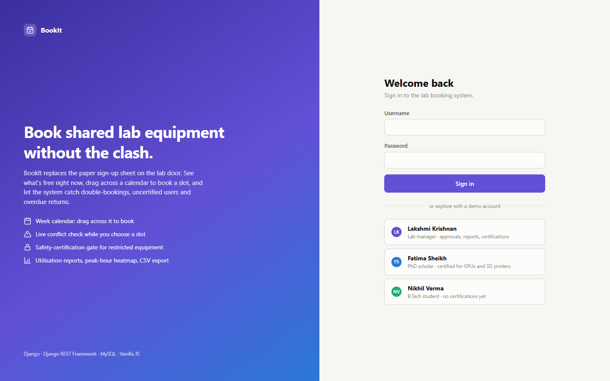 | **Catalog with live status**<br>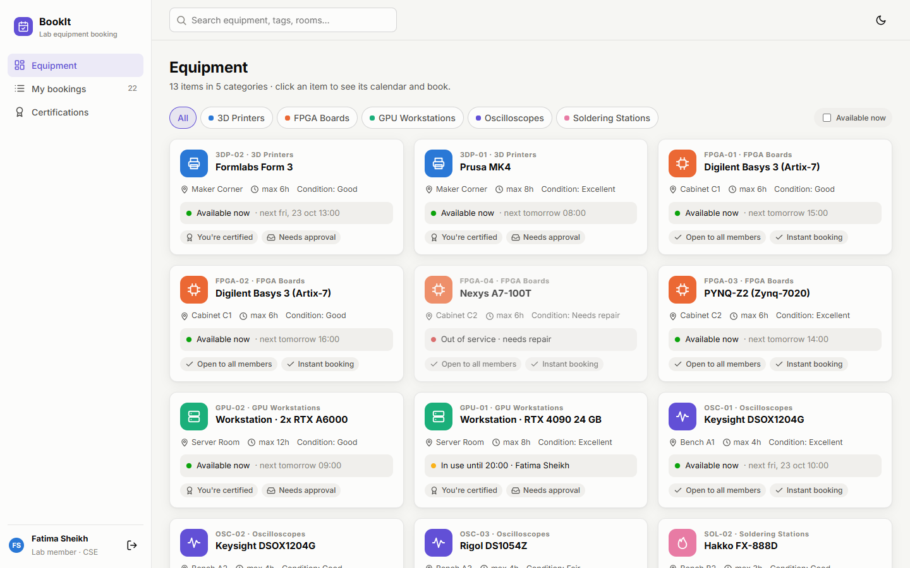 |
| **Drag-to-book: slot is free**<br> | **Live check: slot clashes**<br>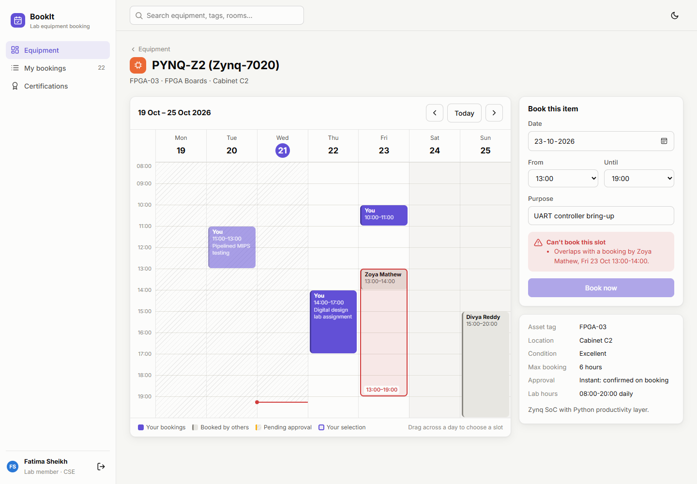 |
| **Certification gate (student)**<br>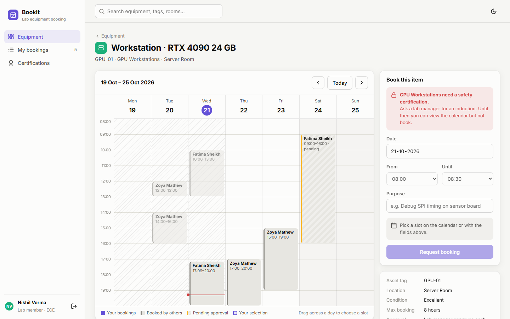 | **My bookings: overdue and rejected**<br>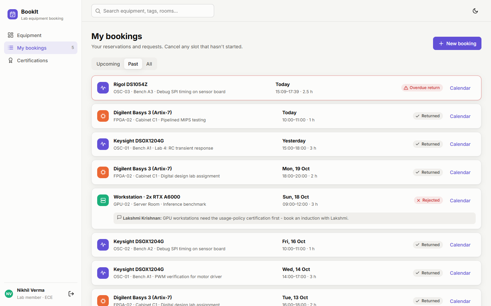 |
| **Approvals and lab desk (manager)**<br>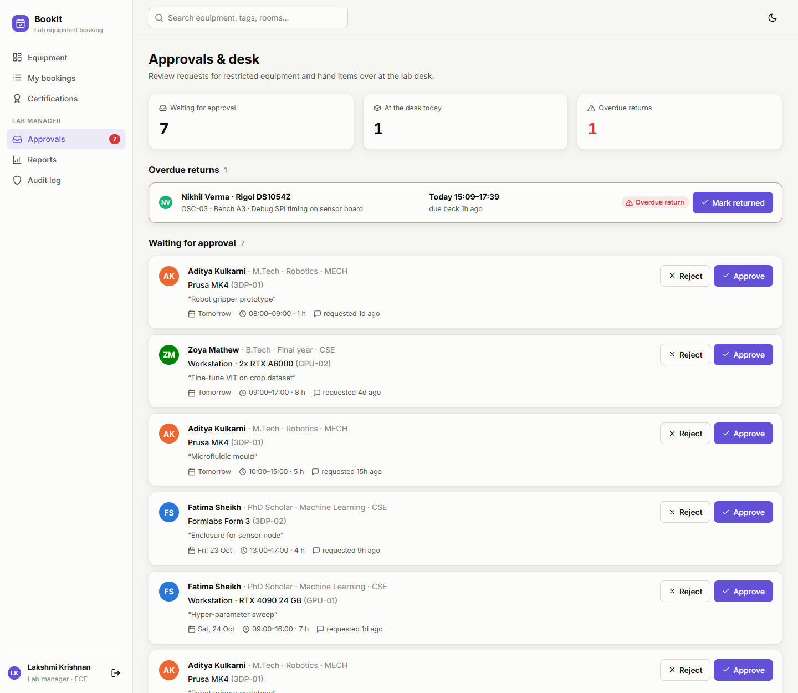 | **Reject with a reason**<br>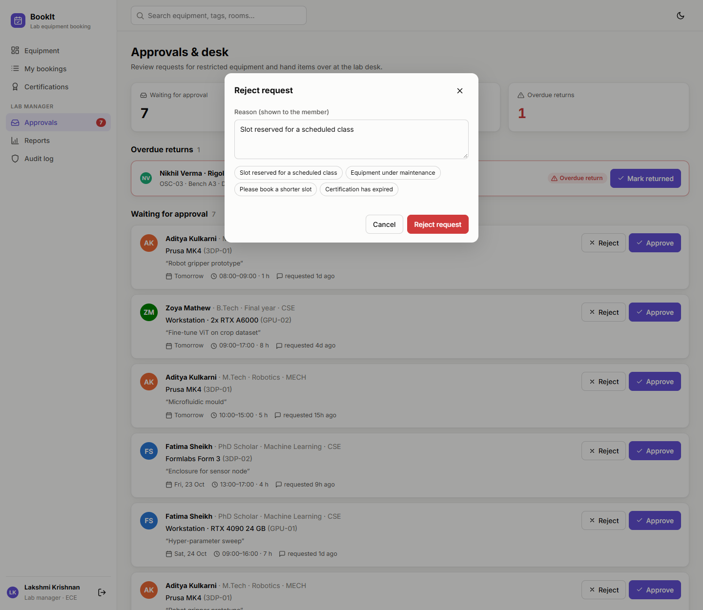 |
| **Reports and peak-hours heatmap**<br>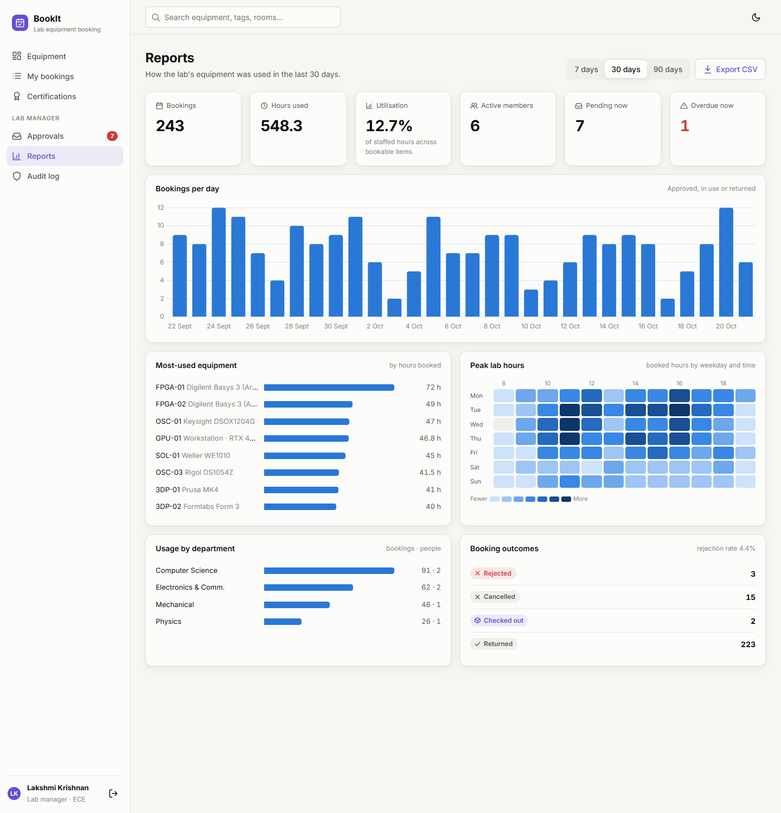 | **Certification matrix**<br>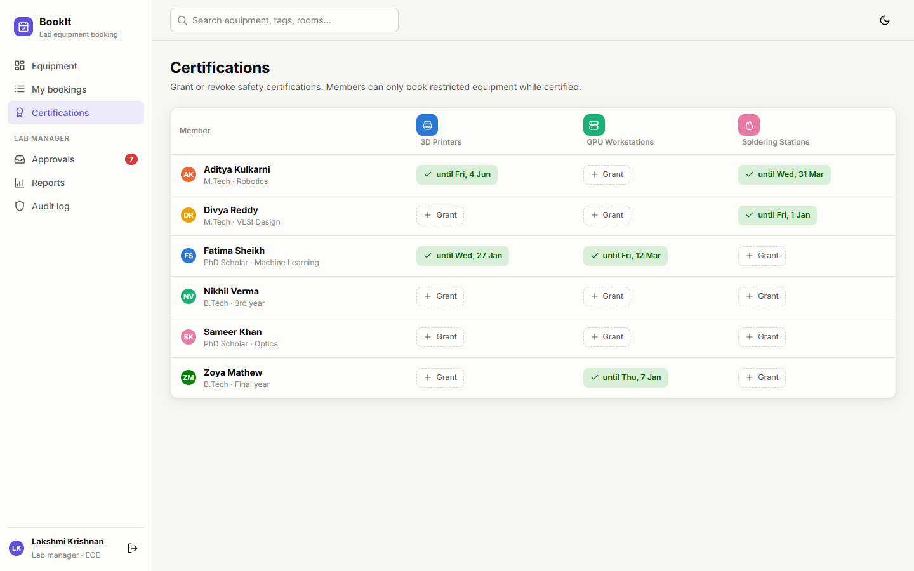 |
| **Audit log**<br>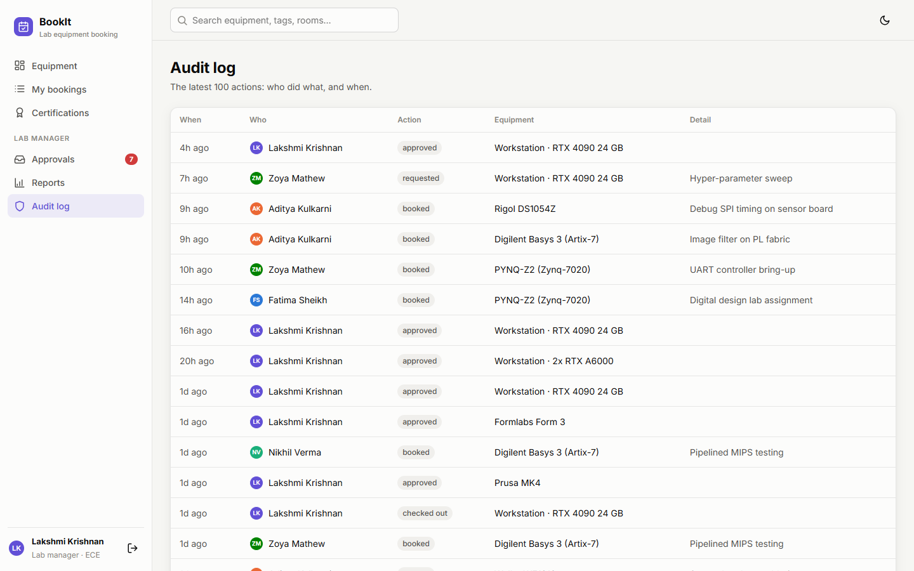 | **Dark mode**<br>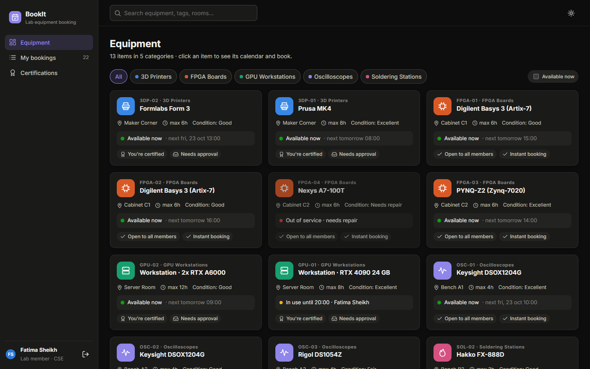 |

## 🧰 Tech stack

| Layer | Technology | Version | What it is used for |
|---|---|---|---|
| Language | **Python** | 3.12 | Backend code |
| Web framework | **Django** | 5.1.4 | Models and ORM, migrations, auth, sessions, CSRF, admin site, templates, test runner |
| API | **Django REST Framework** | 3.15.2 | ViewSets and routers, serializers and validation, custom permission class, lifecycle actions, browsable API |
| Database | **MySQL** | 8.4 | Main relational database (run with Docker Compose) |
| Database (fallback) | **SQLite** | 3 (bundled with Python) | Zero-setup local runs and quick tests |
| MySQL driver | **PyMySQL** | 1.1.1 | Pure-Python driver, so no C compiler is needed on Windows |
| MySQL auth | **cryptography** | 43.0.3 | Lets PyMySQL use MySQL 8's default `caching_sha2_password` login |
| Raw SQL | Hand-written `SELECT … JOIN … GROUP BY` | n/a | Usage-by-department report (portable across SQLite and MySQL) |
| ORM aggregation | `Sum(F("end") - F("start"))`, `Count`, `values().annotate()` | n/a | Hours booked per item, top equipment, utilisation |
| CSV | Python **`csv`** module | stdlib | The bookings export |
| Markup | **HTML5** + Django templates | n/a | Login page and single-page app shell, SVG icon sprite |
| Styling | **CSS3** | n/a | Design tokens (custom properties), Grid and Flexbox layouts, light and dark themes, `color-mix()`, CSS-drawn calendar grid and heatmap |
| Frontend logic | **Vanilla JavaScript** (ES2020+) | n/a | Hash router, `fetch()` API client, **Pointer Events** drag-to-select, debounced live validation, `Date`/time-zone handling. No framework, no bundler |
| Charts | **Chart.js** | 4.4.1 (cdnjs) | Bookings-per-day chart. The heatmap and bar lists are plain HTML and CSS |
| Font | **Inter** | n/a | Loaded from Google Fonts |
| Icons | Hand-drawn inline **SVG sprite** | n/a | 41 icons in [`templates/icons.html`](templates/icons.html), with no icon library |
| Auth | Django **session authentication** + **CSRF** tokens | n/a | Login, role checks, protecting state-changing requests |
| Testing | Django test runner + DRF **`APITestCase`** | n/a | 16 API tests |
| CI | **GitHub Actions** | n/a | Runs check, migrate, seed and tests on **SQLite and MySQL 8.4** for every push |
| Containers | **Docker Compose** | n/a | One-command local MySQL |
| Version control | **Git** + **GitHub** | n/a | Source control and hosting |

## 🏗 Architecture

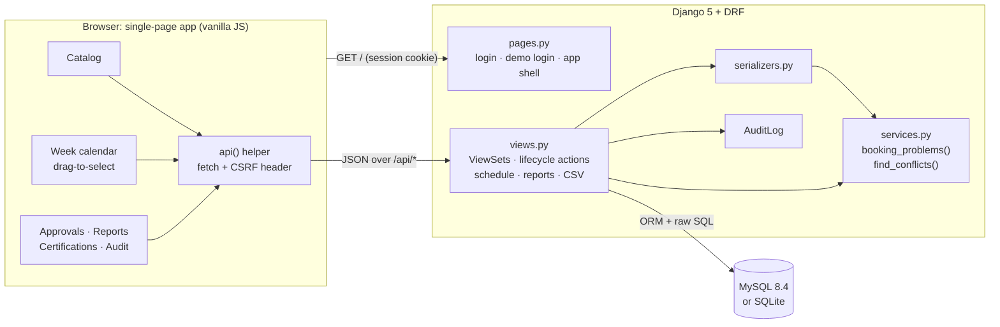

**One booking, end to end:**

1. You drag from 10:00 to 12:00 on Thursday. The calendar draws the selection, and after a 200 ms debounce it calls `GET /api/bookings/check/?equipment=…&start=…&end=…`.
2. `booking_problems()` checks lab hours, maximum duration, service state, certification and **overlaps**, then returns `{ok, problems[], hours, requires_approval}`.
3. You type a purpose and click **Book now**, which sends `POST /api/bookings/`. The serializer runs **the same `booking_problems()` again** on the server, so the rules can't be skipped by calling the API directly.
4. Open equipment is saved as **Approved**. Restricted equipment is saved as **Pending** for a manager to review. An audit entry is written either way.
5. The calendar reloads the week and your booking appears in your colour.

## 🗄 Database design

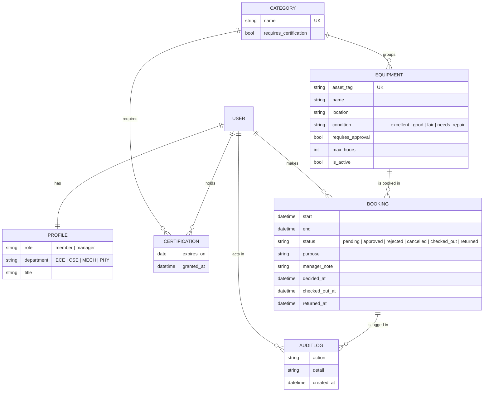

**Constraints and indexes:**

| Constraint or index | Purpose |
|---|---|
| `booking (equipment_id, start, end)` | Keeps the overlap query fast as history grows |
| `booking (user_id, status)` | "My bookings" and per-user counts |
| `booking (status, start)` | Approval queue, lab desk and reports |
| Unique `(user, category)` on certification | One certification per person per category |
| Unique `equipment.asset_tag`, `category.name` | Human-readable identifiers |

## 📏 Booking rules and lifecycle

All rules live in **one function**, `booking_problems()` in [`core/services.py`](core/services.py). It is used by the live check endpoint, the create endpoint and the tests.

| # | Rule | Example message |
|---|---|---|
| 1 | The end must be after the start | *End time must be after the start time.* |
| 2 | Not in the past, and at most 60 days ahead | *You can't book a slot that has already started.* |
| 3 | Same day, inside lab hours 08:00–20:00 | *The lab is open 08:00-20:00.* |
| 4 | Duration ≤ the item's `max_hours` | *… can be booked for at most 4 hours at a time.* |
| 5 | The item is in service | *… is out of service (needs repair).* |
| 6 | A valid, unexpired certification for restricted categories | *3D Printers require a safety certification …* |
| 7 | **No overlap** with pending, approved or checked-out bookings | *Overlaps with a booking by Rahul, Thu 22 Oct 10:00-12:00.* |

**The overlap test.** Two time ranges overlap when **each one starts before the other ends**:

```python
Booking.objects.filter(
    equipment=equipment,
    status__in=("pending", "approved", "checked_out"),
    start__lt=new_end,
    end__gt=new_start,
)
```

```sql
-- the SQL Django runs for it
SELECT … FROM core_booking
WHERE equipment_id = %s
  AND status IN ('pending', 'approved', 'checked_out')
  AND start < %s      -- existing booking starts before the new one ends
  AND `end` > %s;     -- and ends after the new one starts
```

Back-to-back bookings (10:00–12:00, then 12:00–14:00) are allowed. Cancelled and rejected bookings free their slot.

**Lifecycle:**

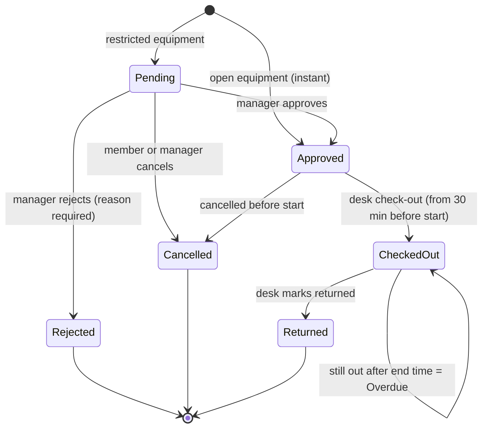

An approval re-checks for clashes with other **approved** bookings first, so a manager can't accidentally approve two overlapping requests.

## 📊 Reports and SQL

The reports page (managers only) is built by `GET /api/reports/summary/?days=30`:

| Report | How it's computed |
|---|---|
| Bookings, hours used, active members | ORM `count()`, `Sum(F("end") - F("start"))`, `values("user").distinct()` |
| **Utilisation %** | Hours booked ÷ (bookable items × 12 lab hours × days) |
| Most-used equipment | `values(...).annotate(n=Count("id"), dur=Sum(duration)).order_by("-dur")` |
| **Usage by department** | **Hand-written SQL**, shown below |
| Bookings per day, **peak-hours heatmap** | Grouped into local-time days and hours in Python, so it works the same on every database |
| Booking outcomes, rejection rate | Count per status |

```sql
SELECT p.department,
       COUNT(b.id)               AS bookings,
       COUNT(DISTINCT b.user_id) AS people
FROM core_booking b
JOIN auth_user u    ON u.id = b.user_id
JOIN core_profile p ON p.user_id = u.id
WHERE b.start >= %s AND b.start < %s
  AND b.status IN ('approved', 'checked_out', 'returned')
GROUP BY p.department
ORDER BY bookings DESC;
```

**Export CSV** (`/api/reports/export.csv?days=30`) streams every booking in the window with these columns: booking ID, asset tag, equipment, category, member, department, start, end, hours, status, purpose and manager note.

## 🔌 REST API reference

Every endpoint lives under `/api/` and requires a logged-in session. Open http://127.0.0.1:8000/api/ in the browser to explore it through DRF's **browsable API**.

| Method | Endpoint | Who | Description |
|---|---|---|---|
| `GET` | `/api/me/` | all | Profile, certified categories, counts (upcoming, pending, overdue) |
| `GET` | `/api/categories/` | all | Categories with item counts (managers can also create and edit) |
| `GET` | `/api/equipment/` | all | Catalog with live `current` and `next_booking`. Filters: `category`, `search`, `available=1` |
| `GET` | `/api/equipment/{id}/` | all | One item, plus `certified` for the current user |
| `GET` | `/api/equipment/{id}/schedule/?start=YYYY-MM-DD&days=7` | all | Bookings for the calendar view |
| `GET` | `/api/bookings/check/?equipment=&start=&end=` | all | **Live validation** of a proposed slot |
| `GET` `POST` | `/api/bookings/` | all | Your bookings, or create one. Filters: `when=upcoming\|past\|today`, `status=`, `equipment=`. Managers can add `scope=all` |
| `POST` | `/api/bookings/{id}/cancel/` | owner or manager | Cancel before the start |
| `POST` | `/api/bookings/{id}/approve/` | manager | Approve a pending request |
| `POST` | `/api/bookings/{id}/reject/` | manager | Reject with `{"note": "reason"}` |
| `POST` | `/api/bookings/{id}/checkout/` | manager | Hand over at the desk |
| `POST` | `/api/bookings/{id}/return/` | manager | Mark returned |
| `GET` `POST` `DELETE` | `/api/certifications/` | members read their own, managers manage all | Grant or revoke certifications |
| `GET` | `/api/reports/summary/?days=30` | manager | All report data |
| `GET` | `/api/reports/export.csv?days=30` | manager | CSV download |
| `GET` | `/api/audit/` | manager | Latest 100 audit entries |

**Example: live check with several problems** (student without certification, 07:00–18:00 on a GPU workstation):

```json
{
  "ok": false,
  "problems": [
    "The lab is open 08:00-20:00.",
    "Workstation · RTX 4090 24 GB can be booked for at most 8 hours at a time.",
    "GPU Workstations require a safety certification. Ask a lab manager to certify you first.",
    "Overlaps with a booking by Zoya Mathew, Fri 23 Oct 15:00-19:00."
  ],
  "hours": 11.0,
  "requires_approval": true
}
```

**Example: one catalog item** (`GET /api/equipment/54/`):

```json
{
  "id": 54,
  "name": "Keysight DSOX1204G",
  "asset_tag": "OSC-02",
  "category": { "id": 21, "name": "Oscilloscopes", "requires_certification": false },
  "location": "Bench A2",
  "condition": "good",
  "requires_approval": false,
  "max_hours": 4,
  "bookable": true,
  "certified": true,
  "current": null,
  "next_booking": { "start": "2026-10-23T04:30:00Z", "end": "2026-10-23T08:30:00Z" }
}
```

## 🚀 Getting started

### Prerequisites
- **Python 3.10+** (developed on 3.12)
- **Git**
- *Optional:* **Docker Desktop**, to run MySQL locally

### 1. Quick start (SQLite, no setup needed)

```bash
git clone https://github.com/Varshini-arsh/bookit-lab-equipment-booking.git
cd bookit-lab-equipment-booking

python -m venv .venv
# Windows
.venv\Scripts\activate
# macOS / Linux
source .venv/bin/activate

pip install -r requirements.txt
python manage.py migrate
python manage.py seed_demo
python manage.py runserver
```

Open **http://127.0.0.1:8000** and click a demo account.

### 2. Run with MySQL

```bash
docker compose up -d          # starts MySQL 8.4 on localhost:3307 (user/password: bookit/bookit)
```

```powershell
# Windows PowerShell
$env:DB_ENGINE="mysql"
python manage.py migrate
python manage.py seed_demo
python manage.py runserver
```

```bash
# macOS / Linux
export DB_ENGINE=mysql
python manage.py migrate && python manage.py seed_demo && python manage.py runserver
```

> BookIt's MySQL uses port **3307**, so it can run next to LabFlow's MySQL on 3306.

### 3. Configuration (environment variables)

| Variable | Default | Meaning |
|---|---|---|
| `DB_ENGINE` | `sqlite` | `mysql` switches to MySQL |
| `DB_NAME` / `DB_USER` / `DB_PASSWORD` | `bookit` | MySQL database and credentials |
| `DB_HOST` / `DB_PORT` | `127.0.0.1` / `3307` | MySQL server address |
| `DJANGO_SECRET_KEY` | dev-only value | **Set a real secret in production** |
| `DJANGO_DEBUG` | `1` | `0` turns off debug mode |
| `DJANGO_ALLOWED_HOSTS` | `localhost,127.0.0.1` | Comma-separated hostnames |
| `DEMO_MODE` | `1` | Shows the one-click demo logins. **Set to `0` in production** |

There is an example in [`.env.example`](.env.example). Lab hours and the time zone (`Asia/Kolkata`) are set in [`core/models.py`](core/models.py) and [`bookit/settings.py`](bookit/settings.py).

### 4. Demo accounts

All passwords are `demo12345`. Each account shows a different side of the app:

| Username | Who | Try this |
|---|---|---|
| `lakshmi` | Lab manager | Approve or reject requests, check items out and back in, read the reports, export CSV, grant certifications, read the audit log. Django admin is at `/admin/` |
| `fatima` | PhD scholar | Certified for GPUs and 3D printers. Book an oscilloscope instantly, or *request* a GPU slot that needs approval |
| `nikhil` | B.Tech student | No certifications, so restricted items are locked. Has a **rejected** request with the manager's note, and an **overdue** return when seeded during lab hours |

## 🧪 Testing and CI

```bash
python manage.py test
```

**16 API tests** in [`core/tests.py`](core/tests.py):

| Area | What is checked |
|---|---|
| Instant vs approval | Open equipment is approved instantly, and restricted equipment stays pending |
| Conflicts | Overlaps are rejected, back-to-back bookings are allowed, cancelling frees the slot |
| Time rules | Lab hours, maximum duration, end before start, slots in the past |
| Equipment state | Out-of-service items can't be booked |
| Certification | Required for restricted categories, and expired certifications don't count. Only managers can grant them |
| Workflow | Members can't approve. Approve → check out (not too early) → return. Reject needs a reason |
| Privacy | Members can't see or cancel other members' bookings |
| Lab desk | The `when=today` filter returns only today's bookings |
| Live check | `/bookings/check/` returns **every** problem at once |
| Reports | Manager-only, correct hours, top equipment, department SQL, CSV contents |

**Continuous integration:** [`.github/workflows/tests.yml`](.github/workflows/tests.yml) runs `check`, `migrate`, `seed_demo` and the full test suite on **both SQLite and a real MySQL 8.4 server** on every push.

## 📁 Project structure

```
bookit-lab-equipment-booking/
├── manage.py
├── requirements.txt              # Django, DRF, PyMySQL, cryptography (pinned)
├── docker-compose.yml            # local MySQL 8.4 on port 3307
├── .env.example                  # configuration template
├── .github/workflows/tests.yml   # CI: SQLite + MySQL test matrix
├── bookit/                       # Django project
│   ├── settings.py               # env-driven settings, DB switch, DRF config
│   ├── urls.py                   # /admin, /api, /login, /
│   └── wsgi.py
├── core/                         # the application
│   ├── models.py                 # Profile, Category, Equipment, Certification, Booking, AuditLog
│   ├── services.py               # booking rules: conflicts, hours, duration, certification
│   ├── serializers.py            # DRF serializers (validation calls services)
│   ├── views.py                  # ViewSets, lifecycle actions, schedule, reports, CSV
│   ├── urls.py                   # API router
│   ├── pages.py                  # login, demo login, app shell
│   ├── signals.py                # auto-create Profile for new users
│   ├── admin.py                  # Django admin configuration
│   ├── tests.py                  # API tests
│   ├── migrations/
│   └── management/commands/seed_demo.py   # case-study data (~6 weeks of bookings)
├── templates/
│   ├── login.html                # sign-in + demo accounts
│   ├── app.html                  # SPA shell (sidebar, topbar, tooltip)
│   ├── head.html                 # shared <head>, theme bootstrap
│   └── icons.html                # inline SVG icon sprite
├── static/
│   ├── css/app.css               # shared design tokens, light/dark themes, components
│   ├── css/bookit.css            # calendar, catalog cards, heatmap, approvals
│   └── js/app.js                 # router, catalog, drag-to-book calendar, approvals, reports
└── docs/screenshots/             # images used in this README
```

## 🧭 Design decisions

| Decision | Why |
|---|---|
| **One rules function (`booking_problems`)** | The live check, the create endpoint and the tests use the same code, so the UI can never promise a slot the API would refuse |
| **Return every problem, not just the first** | Users fix everything in one go instead of hitting errors one at a time |
| **Overlap check covers pending bookings too** | First come, first served: a pending request holds its slot until a manager decides |
| **404 for other people's bookings** | Members can't even confirm that a booking ID exists |
| **Pointer Events for drag-to-select** | One code path for mouse, pen and touch, with 30-minute snapping |
| **Datetime ranges instead of `__date` lookups** | MySQL's `__date` needs time-zone tables loaded, while ranges work on every database |
| **Heatmap and bar lists in HTML and CSS** | Lighter than a chart library, accessible tooltips, and it follows the theme automatically |
| **Session auth instead of JWT** | Same-origin frontend: cookies plus CSRF protection, with no tokens in `localStorage` |
| **SQLite fallback + MySQL in CI** | Zero-setup local runs, while still proving the code works on MySQL |

## 🔭 Future improvements

- Email or in-app notifications for approvals, reminders before a slot starts, and overdue alerts
- Recurring bookings (for example, every Tuesday for a course lab) and a waitlist for busy items
- QR codes on equipment for one-scan check-out and return
- Calendar export (iCal) and Google Calendar sync
- Production deployment guide (Gunicorn, Nginx, managed MySQL)

## 👩‍💻 Author and license

Built by **[Varshini-arsh](https://github.com/Varshini-arsh)**.

Released under the [MIT License](LICENSE).
